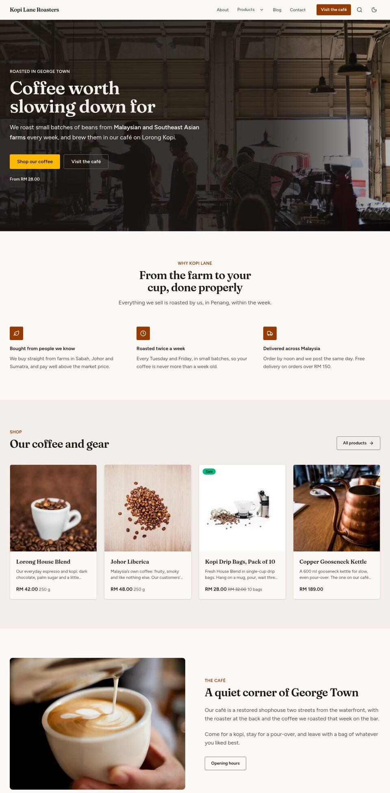
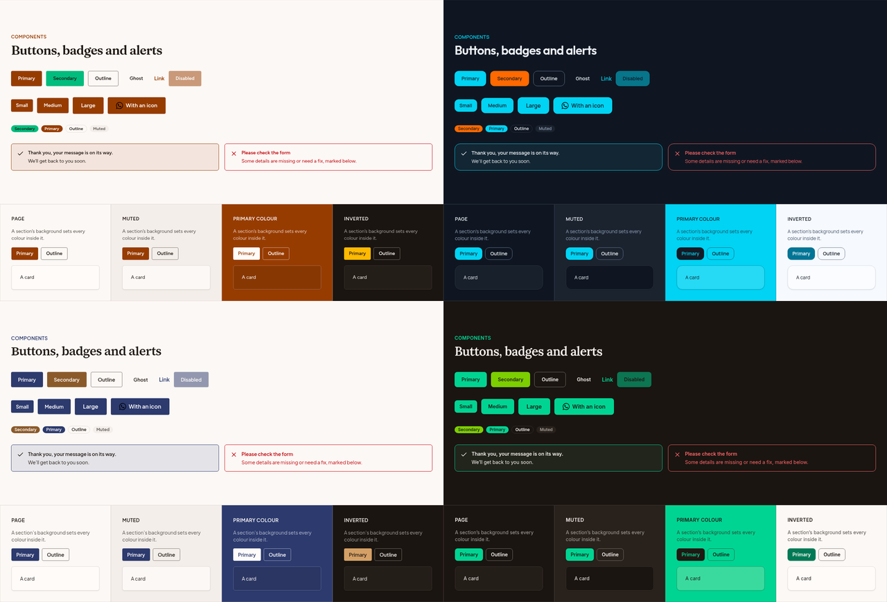

# Penang

A finished website for a small business, as a Statamic 6 starter kit: pages built from twenty sections in the control panel, a theme builder that changes the whole look from one screen, products, a blog, a team, an enquiry form and a WhatsApp button. It runs on **Statamic Core**, the free edition: one user and one form are all it needs, so a client site needs no Pro licence.

Built on Blade, Laravel, Statamic and Tailwind CSS v4, with no Antlers. SEO, share cards, sitemaps and analytics come from the free [Marketing Toolkit](https://statamic.com/addons/jothamlec/marketing-toolkit).

**Live demo:** <https://penang.cothink.ing> (try the presets with the Theme button at the bottom left).



## What's in it

- **A page builder**: Home, About, Contact and any page you add are built from sections editors add, reorder and switch off in the control panel. Each section has a few layouts and takes any of four backgrounds.
- **A theme builder**: five presets (fonts, corners and colours chosen together) and light or dark, chosen in one global and applied with no rebuild; a preset for a brand is a few lines of code, its colours used exactly where they read.
- **Content**: Products as a catalogue (categories, prices and sale prices, New/Sale badges, a details list, stock, buttons to your Shopee or Lazada shop, and "Ask on WhatsApp"), a Blog with categories, the Team, and sample content for a made-up Penang coffee roaster.
- **Listings**: featured rows per category on the products page, pages of products and articles, and breadcrumbs in step with the structured data.
- **Site search** of pages, products and articles (Statamic's own, on Core), and a **legal page** kind with a table of contents for privacy and terms.
- **One enquiry form**, stored in the control panel and sent as a lead to your analytics, with an optional confirmation email to the visitor in the theme's colours (`resources/views/emails/enquiry-confirmation.blade.php`).
- **A WhatsApp button** on every page, from one number.
- **SEO and analytics**: titles, descriptions, Open Graph cards, structured data (local business, products, articles, FAQs), the sitemap, redirects and tracking, through the Marketing Toolkit.
- **A user manual** for the person who edits the site: [docs/user-manual.md](export/docs/user-manual.md), installed with the site.
- **Accessible by default**: every text colour is chosen for WCAG AA contrast in every theme, keyboard-friendly menus and forms, visible focus, and light and dark modes.

## The page builder

Pages are one `blocks` [Replicator](https://statamic.dev/fieldtypes/replicator) field with twenty sets, each a Blade view in `resources/views/components/blocks/`:

| Section | Layouts |
|---|---|
| Hero | Centred · beside a picture (left or right) · text on a photo or a silent video loop; optionally the lowest product price |
| Text | Left · centred; headings, lists, quotes and tables |
| Picture and text | Picture left or right · landscape, square or portrait · up to four pictures as a collage or a column, with captions |
| Gallery | Even grid or masonry, 2–4 columns, captions, a larger view (`<dialog>`, arrow keys, Escape) |
| Video | YouTube, Vimeo or an uploaded file behind a cover, loaded only on play · wide or beside text |
| Features | Icon grid of 2, 3 or 4 columns · cards · beside the heading; any of Lucide's icons (searchable) or a picture per point |
| Steps | Numbered (or labelled, or with icons) steps across the page · down it as a timeline |
| Tabs | Titled panels of text and a picture (ARIA tabs, arrow keys) |
| Products | Featured · in list order · chosen by hand; 3 or 4 columns |
| Team | Portraits · small photos |
| Latest articles | Cards · list |
| Testimonials | One large quote (or a note signed by several people, with signatures or names by hand) · grid · carousel; stars, where it was left, a logo; buttons |
| Logos | Row · boxed grid · scrolling (paused for reduced motion); a link per logo |
| Figures | Row · beside a picture |
| Table | Rows and columns with a heading row and row names, scrolling sideways on phones |
| Prices | One to four packages with a price, what's included and a button; one can stand out |
| Questions | Accordion · beside the heading |
| Call to action | Centred · panel · beside a picture |
| Enquiry form | With or without the contact details |
| Map and address | Map, address, opening hours, Google Maps and Waze directions |

**Globals → Site settings** also has an **announcement bar** above the header (a sale, holiday hours), with a link, which visitors can close until it changes.

Not included, on purpose: a newsletter signup (Statamic Core allows one form, which is the enquiry form; use your mailing tool's own form or link), exit-intent popups (intrusive) and decorative shape dividers (easy to add to a site's own sections). Each is a small addition for a site that wants it.

Every section also takes a background (page, muted, primary colour, inverted), spacing and an anchor. Introductions, a hero's text and a call to action's text take bold, italics and links. Up to three **buttons** per section each go to a page or address, WhatsApp (with its own first message), a phone call, an email or a file, and can open in a new tab. Editors pick sections from pictures of them:


`/components` shows every section and component in the current theme, which is also the page to try themes on.

## The theme builder

**Globals → Theme** holds a **preset**: a whole look, with its fonts, corners, base colour (the greys of backgrounds, text and borders) and primary and secondary colours chosen to go together. Five come with Penang: Default, Kopitiam (warm), Pantai (sea), Hutan (forest) and Batik (indigo and soga brown). Editors choose a preset and light, dark or the visitor's choice; they don't mix a preset with settings of their own, so every combination on the site has been seen and checked.

**A preset for a client's brand** is how a site gets its own look. Add it to `PRESETS` in `app/Theme/Options.php`: one of the fourteen fonts for headings and one for text, the corners, a base, and the primary and secondary colours, by Tailwind's names or as hex values (and optionally `primary_dark`, dark mode's primary, where the brand colour would only turn pale). A hex colour is used exactly as given wherever it passes the contrast rules, and stepped to a lighter or darker shade of itself only where it doesn't.

```php
'acme' => [
    'label' => 'Acme',
    'heading_font' => 'cormorant-garamond', 'body_font' => 'montserrat', 'radius' => 'small',
    'base' => 'stone', 'primary' => '#5a2850', 'secondary' => '#cea05f',
],
```

Then add it to the Preset field's options in `resources/blueprints/globals/theme.yaml` (`acme: Acme`), choose it under Globals → Theme, and check it on `/components` in light and dark. Keep the other presets or remove them, as suits the client.



How it works:

1. `App\Theme\Theme` turns the settings into semantic tokens, as shadcn names them: `background`, `foreground`, `card`, `muted`, `primary`, `primary-foreground`, `secondary`, `accent`, `border`, `input`, `ring`, `destructive`, `radius` and the two font families. Each colour comes in light and dark, as `light-dark()`.
2. Each `*-foreground` is picked for WCAG AA contrast with its background, and so is the shade of the primary colour: a yellow becomes a deeper gold where it has to carry text. Hover colours and tints are mixed in the browser with `color-mix(in oklab, …)`.
3. Nothing is pure white or black. The light page is an off-white in the base colour's tone (warm with stone, cool with slate), text a deep grey in the same tone, and the dark page a deep toned grey; buttons, hovers, the photo scrim and shadows use those ends too.
4. The layout prints the tokens as CSS custom properties in `<head>`; `resources/css/site.css` maps them to Tailwind with `@theme inline`, so `bg-primary`, `text-muted-foreground` and `rounded-lg` follow the theme. Saving the theme changes the site at once, with no build.
5. Each section background (`data-tone`) sets the same tokens again for what's inside it, so buttons and cards in a primary-coloured band stay readable.
6. Tailwind's own palette is switched off (`--color-*: initial`): views can only use the theme's colours.

The fourteen fonts: Inter, Manrope, Plus Jakarta Sans, Figtree, Outfit, Montserrat, Poppins and DM Sans; Lora, Fraunces and Source Serif; and, for headings, Cormorant Garamond, Playfair Display and DM Serif Display.

Signed in to the control panel, you get a **Theme** button on the site to try the presets before saving one; only you see it.

## Requirements

- PHP 8.3+, with the extensions Statamic needs
- Statamic 6.35+ (Core is enough) on Laravel 13
- A database for the Marketing Toolkit's tables (SQLite is fine, and is Laravel's default)
- Optional: PHP's `imagick` for the toolkit's generated share cards
- Node 20+ only to change templates or styles (the built assets are included)

## Installing

Penang is a paid starter kit on the [Statamic Marketplace](https://statamic.com/starter-kits); the installer asks for its licence key.

```bash
statamic new my-site jotham-lec/statamic-penang
```

or, in a new Statamic site (`--clear-site` removes the new site's own sample views first, as `statamic new` does; don't use it on a site with content you want to keep):

```bash
php please starter-kit:install jotham-lec/statamic-penang --clear-site
```

The installer runs the Marketing Toolkit's migrations and offers to remove the empty `public/robots.txt` and `public/favicon.ico` a new site has, so the toolkit can serve its own. Then:

1. Create your user: `php please make:user --super` (Statamic Core has one).
2. Set `APP_URL` in `.env` to the site's address.
3. In the control panel, replace the sample business: **Marketing → Brand** (name, phone, email, address, map position, opening hours, social profiles), **Globals → Site settings** (WhatsApp number, more phone numbers, header button, footer text, note and legal line, labels) and **Globals → Theme**.
4. Replace or delete the sample pages, products, articles, team and pictures.
5. Hand `docs/user-manual.md` ([read it here](export/docs/user-manual.md)) to whoever edits the site.

If you change views or styles: `npm install && npm run build`.

## Where things are

| | |
|---|---|
| `resources/fieldsets/page_builder.yaml` | The sections and their fields |
| `resources/fieldsets/section_options.yaml`, `buttons.yaml` | Fields every section shares |
| `resources/views/components/blocks/` | One view per section |
| `resources/views/components/site/` | Header, footer, announcement bar, WhatsApp button, theme switcher |
| `resources/views/components/ui/` | Button, card, badge, field, alert, avatar |
| `resources/views/components/layout.blade.php` | The shell: head, header, footer |
| `resources/views/showcase.blade.php` | The components page |
| `app/Theme/` | The theme builder: options and presets (`Options.php`), tokens (`Theme.php`), colour sums (`Colour.php`) |
| `app/Support/Business.php` | Contact details, hours and the WhatsApp link, read from Marketing → Brand and Site settings |
| `app/Support/Button.php`, `Labels.php` | Where each type of button goes; the editable wording |
| `app/Providers/PenangServiceProvider.php` | The words of a page's sections, for site search |
| `resources/css/site.css` | Tailwind and the token mapping |
| `config/penang.php` | The theme switcher for a demo site |
| `config/marketing-toolkit.php` | SEO rules for the collections |
| `config/statamic/search.php` | What site search covers (`php please search:update` rebuilds it) |
| `resources/views/search.blade.php`, `legal.blade.php` | The search results and legal page kinds (a page's *Kind of page*) |

**To add a section**: add a set to `page_builder.yaml` (in the control panel, Fieldsets → Page builder, or in the file) with `import: section_options` last, and a view `components/blocks/{set-handle}.blade.php` that wraps its content in `<x-section :block="$block">`. Use only the theme's colours (`bg-primary`, `text-muted-foreground`…).

**To add a preset or a font**: add it to `app/Theme/Options.php` (a font also needs its `.woff2` in `resources/fonts/{key}/` and an `@font-face` in `resources/css/fonts.css`). The Theme global lists the presets from there (run `php DEV_FILES/build/model.php` in the working site, or add the option to `resources/blueprints/globals/theme.yaml`).

**Wording**: what the templates write themselves ("All products", "Ask for a price", "Out of stock", the WhatsApp label, the 404 page…) is editable under **Globals → Site settings → Labels**, and the form's button and thank-you message on each Enquiry form section. The rest (screen-reader labels, dates, days) goes through `__()`: `lang/ms.json` (Malay) and `lang/zh_CN.json` (Simplified Chinese) are included, used when the site's language (Settings → Sites, `lang`) is `ms` or `zh_CN`; add `lang/{lang}.json` for another. Laravel's own form-validation messages need [laravel-lang](https://laravel-lang.com) for those languages.

**A demo site**: `PENANG_THEME_PREVIEW=true` in `.env` shows the theme switcher to every visitor, each in their own browser.

## External services

Nothing is sent anywhere without the visitor doing it:

- **Map and address** shows a map from OpenStreetMap in a frame, loaded by the visitor's browser when they scroll to it. Leave the map position empty in Marketing → Brand to show no map.
- **WhatsApp**, **Google Maps** and **Waze** are links the visitor chooses to follow.
- The Marketing Toolkit's tracking only runs with the IDs you set, and under Consent Mode; its external requests are listed in [its documentation](https://github.com/Jotham-LEC/statamic-marketing-toolkit/blob/main/docs/configuration.md).

## Licence, credits and support

Penang is sold under the licence in [LICENSE.md](LICENSE.md): one licence per site. The fonts, icons and photos it includes are open-licence or public domain, credited in [NOTICE.md](export/NOTICE.md). The Marketing Toolkit it installs is free and MIT-licensed.

Questions and bugs: [GitHub issues](https://github.com/Jotham-LEC/statamic-penang/issues). Changes are in [CHANGELOG.md](CHANGELOG.md).
