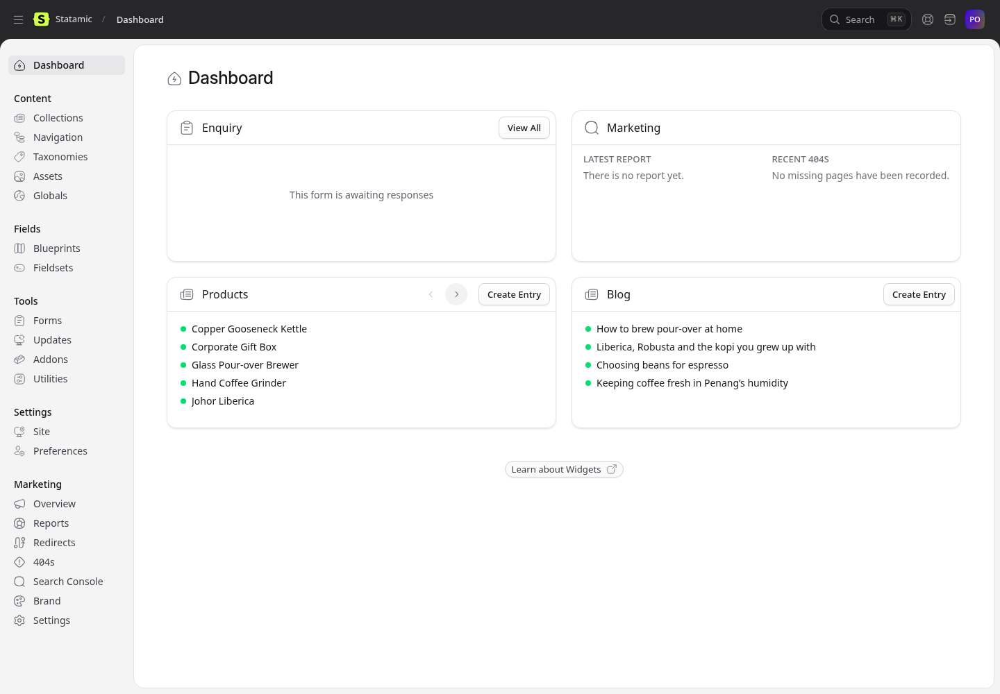
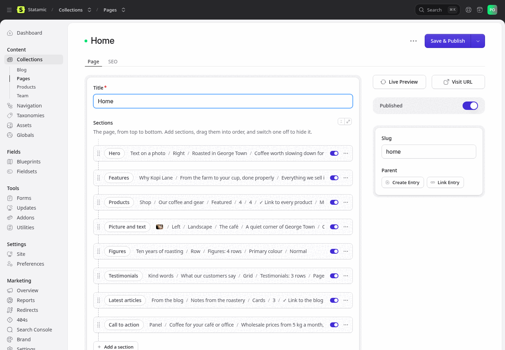
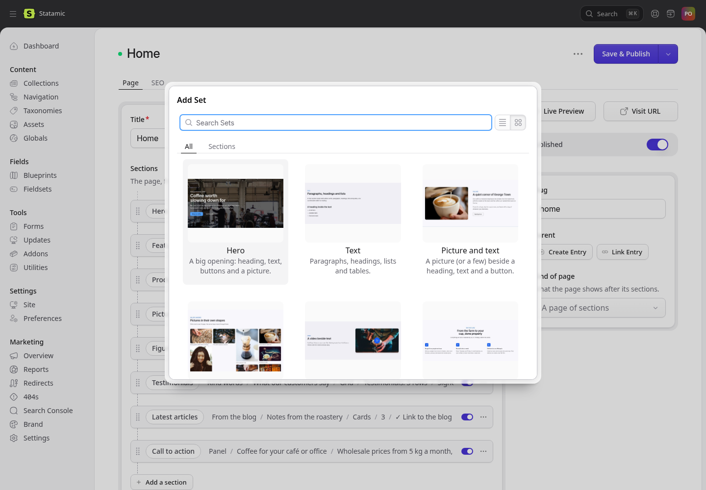
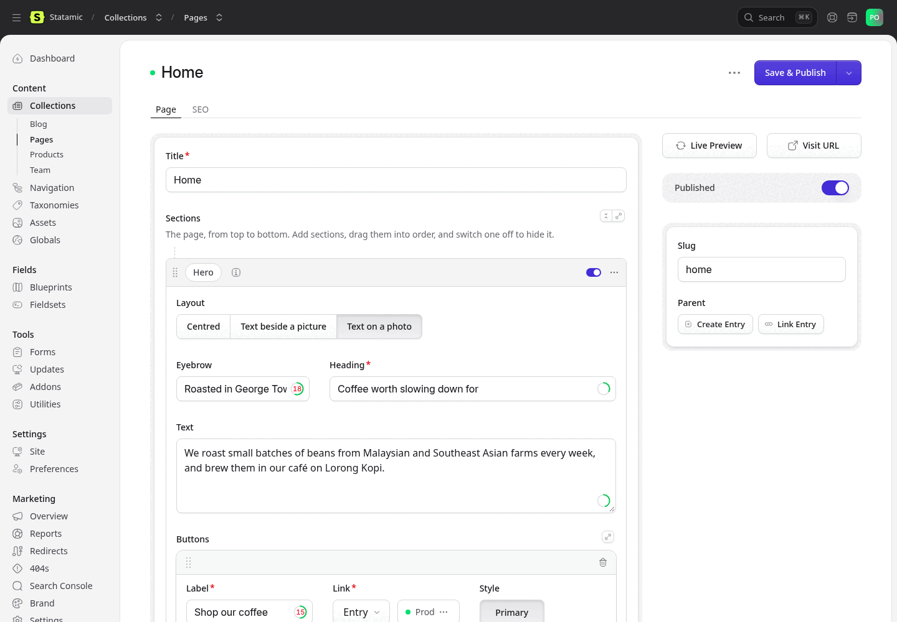
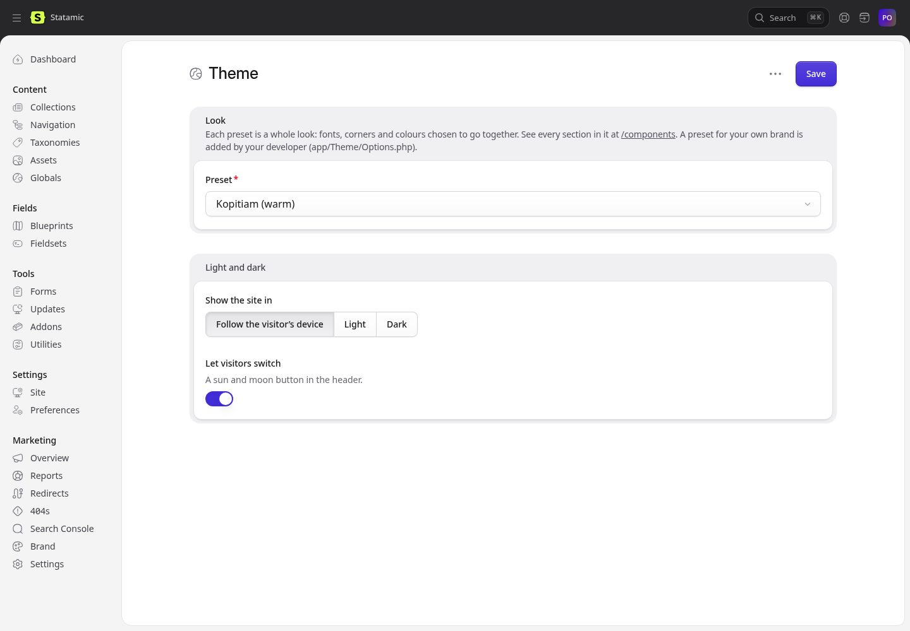

# Looking after your website

This guide is for the person who keeps the website up to date: changing text and pictures, adding products and blog articles, and reading enquiries. You don't need to know any code. Everything is done in the **control panel**, at your website's address followed by `/cp` (for example `https://yourbusiness.com.my/cp`).

The website comes with sample content for a made-up coffee shop, Kopi Lane Roasters. Your developer usually replaces it with yours before the site goes live; if any of it is still there, replace it the same way you edit anything else.

## Signing in

Go to `/cp` and sign in with the email address and password you were given. The website has one account, so keep the password safe and don't share it. If you forget it, use **Forgot password?** on the sign-in page.

After signing in you see the **Dashboard**: the latest enquiries, your products and blog articles, and your website's SEO score.

## Editing a page

Pages are under **Collections → Pages**: Home, About, Products, Blog, Contact and Components. Click a page to open it.

A page is made of **sections**, stacked from top to bottom: a big opening (the hero), a few points about your business, your products, a call to action, and so on. Each section shows as a row with a short summary.

- **Change a section**: click its row to open it, change the text or pictures, then click **Save & Publish** (top right). Nothing changes on the website until you save.
- **Add a section**: click **Add a section** under the last one, and choose from the list. Each kind has a picture of how it looks.
- **Move a section**: drag it by the dots on its left.
- **Hide a section** without deleting it: switch it off with the switch on its right. Switch it on again to bring it back.
- **Delete a section**: open the **⋯** menu on its right and choose **Delete**.
- **See your changes before saving**: click **Live Preview**. The preview updates as you type.

Inside a section, the buttons in a row (like *Centred / Text beside a picture / Text on a photo*) are choices: click one to choose it. Most sections also have, at the bottom:

- **Background**: *Page* (the same as the page), *Muted* (a soft grey band), *Primary colour* (a band in your main colour) or *Inverted* (dark on a light site). Alternating backgrounds helps visitors see where one section ends.
- **Spacing**: how much room is above and below.
- **Anchor**: a short name like `prices`, so a button or link can jump straight to this section with `#prices`.

Fields you leave empty simply don't show on the website, so you never need to fill in everything.

Short texts like an introduction have a small toolbar when you select words: **bold**, *italics* and a link.

**Buttons**: a section can have up to three. Choose where each one goes (*Goes to*): a page or web address, **WhatsApp** (your number from Site settings; you can write the first message the visitor sends), **a phone call** or **an email** (your phone or email from Marketing → Brand, unless you type another), or **a file** such as a price list. Then its label and style. A button with nowhere to go doesn't show.

### The sections

| Section | What it's for |
|---|---|
| **Hero** | The big opening of a page. Centred, beside a picture, or on top of a full-width photo (or a short silent video). Use a short heading. *Show the lowest price* adds "From RM …" from your products. |
| **Text** | Paragraphs, headings, lists, quotes and tables (the table button adds one). |
| **Picture and text** | A picture (or up to four, with their captions) beside a heading and some text, with a button if you like. |
| **Gallery** | A grid of pictures. Visitors click one to see it larger. |
| **Video** | A YouTube or Vimeo video, or one you upload. It loads only when the visitor presses play. |
| **Features** | A few short points with icons or pictures: why choose you, what you offer. |
| **Steps** | How it works, as numbered steps (or with an icon each), or a timeline with dates. |
| **Tabs** | A few titled panels; the visitor picks one at a time. |
| **Products** | Product cards: your featured products, the first few in your list, or ones you choose. |
| **Team** | The people in your Team list, as portraits or small photos. |
| **Latest articles** | Your newest blog articles. |
| **Testimonials** | What customers say: one big quote, a grid, or a carousel, with stars and where the review was left. One quote can be a note from your team, signed by several of you: upload each signature, or switch on *Write names by hand*. Buttons can follow. |
| **Logos** | Logos of clients, partners or press, in a row, a grid or scrolling past. Upload each logo with its name as the alt text, and its website as the link. |
| **Table** | Rows and columns: a price list, delivery areas, a comparison. |
| **Prices** | Up to four packages side by side, with what each includes; one can stand out. |
| **Figures** | A few numbers that tell your story: years in business, customers served. |
| **Questions** | Frequently asked questions. Each opens to show its answer. Google also reads them. |
| **Call to action** | Ask the visitor to do something: get in touch, visit, order. Its buttons can open WhatsApp. |
| **Enquiry form** | The enquiry form, with your phone, email, WhatsApp and address beside it. You can change the send button's label and the thank-you message. |
| **Map and address** | A map of where you are, your address and opening hours, with directions in Google Maps and Waze. |

### Kinds of page

A page's sidebar has **Kind of page**. Most pages are just their sections. The other kinds add something after the sections:

- **Legal page**: for a privacy notice or terms. Write each part as a **Text** section with a heading; the page lists those headings as a table of contents beside them, and shows the date you last saved it.
- **Search results**: a search box and what it finds among your pages, products and articles. Choose this page under **Globals → Site settings → Search** to put a search button at the top of every page.
- **Every product** and **Every blog article**: the Products and Blog pages.

A page placed under another (with *Parent*, or by dragging it under another in the Pages list) shows a trail back to it at the top: *Home › About › Our story*.

### Adding a page

In **Collections → Pages**, click **Create Entry**, give the page a title and add its sections. To show it in the menu, add it under **Navigation** (see [Menus](#menus)).

## Products

Products are under **Collections → Products**. Click one to edit it, or **Create Entry** for a new one.

- **Name**, **Summary** (one or two sentences, shown on the product cards; without one, the cards show the start of the description) and **Description** (the full text on the product's own page).
- **Details**: a short list under the description, like *What's inside* or sizes and materials. Give it a heading and add a line per item.
- **Buy elsewhere**: buttons to the same product in your Shopee, Lazada or other online shop.
- **Pictures**: the first is the main one. Square or landscape pictures look best.
- **Price**: the number only, without "RM". Leave it empty to show "Ask for a price". **Price note** is a few words after the price, like "per box" or "250 g".
- **Price before**: for a sale, the old price; it shows crossed out beside the new one.
- **Badge**: *New*, *Sale*, or your own word (like "Bestseller") on the product's picture.
- **In stock**: switch off to show "Out of stock".
- **Featured**: switch on to show it in *Products* sections set to *Featured*.
- **Categories**: choose one or more, or type a new one.

The **Products** page lists every product, a page at a time, and above them a row of featured products for each of your first few categories. Set how many rows (0 for none) and how many products per page under **Globals → Site settings → Products page**.

To change the **order** products are listed in, drag them in the Products list. Visitors can't buy on the website: each product page has an **Ask on WhatsApp** button (which names the product in the message) and a **Send an enquiry** button.

## Blog articles

Blog articles are under **Collections → Blog**. Click **Create Entry**, then fill in the title, a short **Summary** (shown in lists and in Google), a **Main picture**, the article itself, who wrote it and its **Categories** (choose one or more, or type a new one). Each category gets its own page listing its articles, linked from the blog. The **Date** decides the order; an article with a future date appears on that day.

In the article, use the toolbar for headings, bold, lists and links, and the picture button to add a photo.

## Team

Your people are under **Collections → Team**: name, role, a portrait photo and a short bio. Drag them in the list to change their order on the website.

## Pictures

Pictures live in **Assets**. Upload them there, or straight from any picture field with **Browse** or by dragging a file in.

- **Describe every picture**: click it in Assets and fill in **Alt text**, for example "A latte with a heart drawn in the milk". People who can't see the picture hear this, and search engines read it.
- **Choose what stays in view**: pictures are cropped to fit each layout. In the picture's settings, use **Focal point** to click on what matters (a face, a product), and the crop keeps it in view.
- **Caption** and **link**: a picture's caption shows under it in a Gallery and in Picture and text; a logo's link makes it clickable in a Logos section.
- Large photos are fine: the website makes smaller copies for phones by itself.
- **Videos** (MP4) can be uploaded too, for the Video section or behind a hero. Keep them short and small (under 10 MB); for anything longer, upload to YouTube and paste its address.

## Menus

The menus are under **Navigation**:

- **Main menu**: the links at the top of every page (and in the menu on phones).
- **Footer menu**: the links at the bottom. A top-level item with links under it becomes a column with that heading.

In the Main menu, a link placed under another opens as a small dropdown menu from it (on phones, it's listed under it).

Click **Add Nav Item** and choose **Link to Entry** for one of your pages, or **Link to URL** for anywhere else. Drag to reorder; drag a link under another to put it in that column.

## Enquiries

Every message sent through the enquiry form is saved under **Forms → Enquiry**, newest first. Click one to read it. **Export** downloads them all as a spreadsheet.

To receive each enquiry by email as well, open **Forms → Enquiry → Configure**, and under **Email** add your email address. (Your developer may need to set up email sending for the website first.)

**A thank-you email to the visitor**: in **Forms → Enquiry → Configure**, under **Email**, add an email with *Recipient* `{{ email }}` (the address the visitor typed), a *Subject* such as "Thank you for your message", and *HTML view* `emails/enquiry-confirmation`. Each visitor then gets an email in your website's colours, thanking them and repeating what they sent, with your WhatsApp, phone and email. Add a second email to your own address to be told of each enquiry. (Sending email needs your developer to set it up for the website first.)

The website has one form, as the edition of Statamic it runs on (Statamic Core) allows. You can add or change its fields under **Forms → Enquiry → Edit Blueprint**; the website shows new fields by itself.

## Your business details

Your phone, email, address, opening hours and social media links appear in several places: the footer, the contact page and the map. You fill them in once:

- **Marketing → Brand**: the **default share image**, the picture shown when a page is shared and has no picture of its own (a share card is otherwise drawn for each page by itself). Use a 1200 × 630 picture of your business with its name.
- **Marketing → Brand → Publisher**: the business name, phone, email, address, the map position (latitude and longitude: in Google Maps, right-click your shop and click the numbers to copy them), opening hours and social media links (under *Profiles elsewhere*, one full address each, like `https://www.instagram.com/yourbusiness`).
- **Globals → Site settings**: your **WhatsApp number** (with the country code, for example `60 12-345 6789`; the green WhatsApp button appears on every page once it is filled in), the first message visitors see, the button at the top right of every page, more phone numbers (each with a label, and whether it takes WhatsApp), and, for the footer, a short text about your business, a note (like "We reply within one working day") and a legal line (your company name and registration number).

### The announcement bar

**Globals → Site settings → Announcement** puts a coloured bar above the top of every page: a sale, holiday hours, a new branch. Add a link if you like. Visitors can close it; it comes back for them when you change the text. Empty it to remove the bar.

### The website's own wording

The website writes some words by itself: "All products", "Ask for a price", "Out of stock", "Chat on WhatsApp", the "page not found" page, and so on. To use your own words (say, "All baskets" or "Price on request"), open **Globals → Site settings → Labels** and type them in. A label left empty keeps the wording shown in grey.

## The look of your website

Under **Globals → Theme** you change how the whole website looks, without touching any page:

- **Preset**: the look of the whole website: its fonts, corners and colours, chosen to go together. *Default*, *Kopitiam* (warm), *Pantai* (sea), *Hutan* (forest) and *Batik* (indigo and soga brown). Choose one and save.
- **Light and dark**: whether the website shows light, dark, or follows each visitor's phone or computer, and whether visitors may switch.

Text always stays readable in every preset, light and dark. For a look in your own brand's colours and fonts, ask your developer to add a preset for it; it then appears in the list.

**To try a preset before saving it**, visit the website while signed in: a **Theme** button at the bottom left lets you try each one. Only you see it, and nothing changes until you save under Globals → Theme. The **Components** page (`/components`) shows every part of the website at once, which makes it the best page to try them on.

## Search engines and sharing

Each page, product and article has an **SEO** tab. You can leave it empty: the website writes the title, description and share picture from the page itself. Fill it in when you want a particular title or description in Google, or a particular picture when the page is shared on Facebook or WhatsApp. The tab shows a preview of both.

The **Marketing** section of the control panel holds your SEO score (**Reports**), **Redirects** (send an old address to a new one) and the list of addresses visitors tried that don't exist (**404s**). Its own guide is at <https://github.com/Jotham-LEC/statamic-marketing-toolkit/blob/main/docs/editors.md>.

## When something looks wrong

- **A change doesn't show**: check that you clicked **Save & Publish**, then reload the page in your browser.
- **A section is missing**: check that its switch is on, and that it has what it needs (a Products section needs products; a Map needs the map position in Marketing → Brand).
- **Anything else**: ask your developer. Tell them the page's address and what you expected to see.
